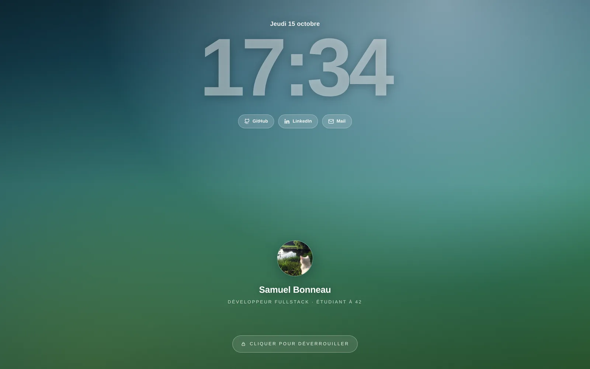
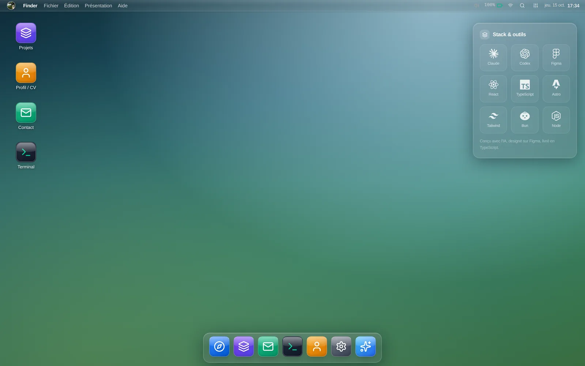
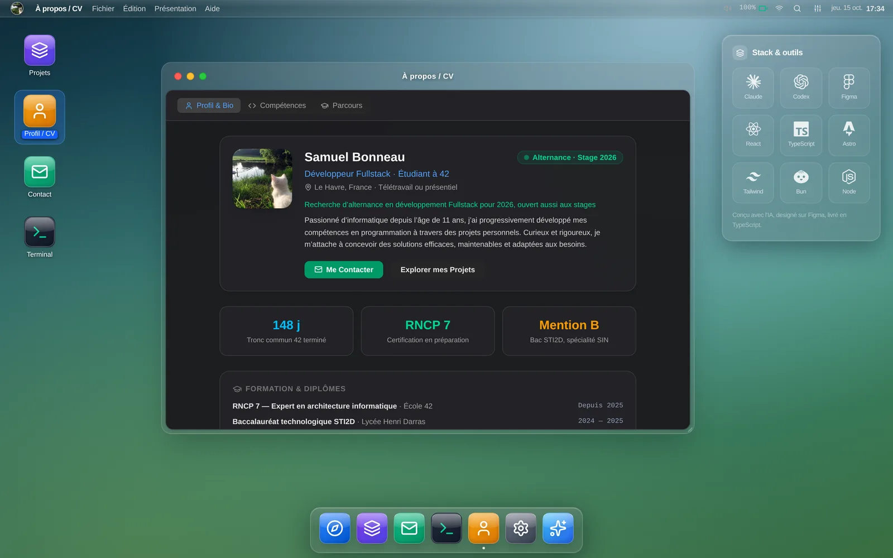
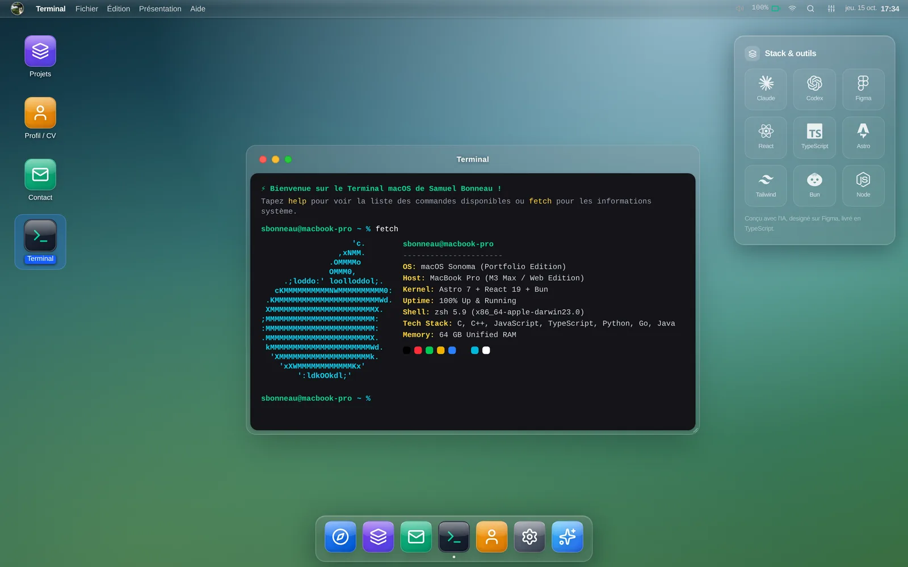
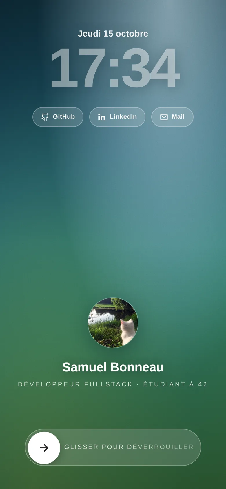
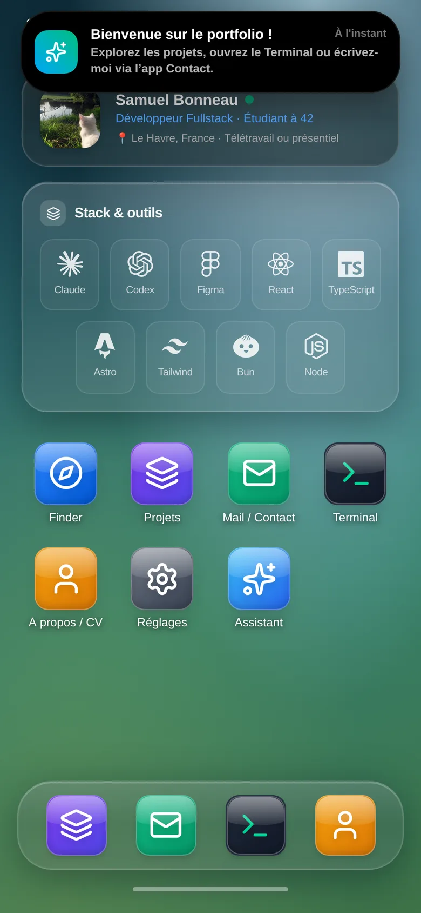
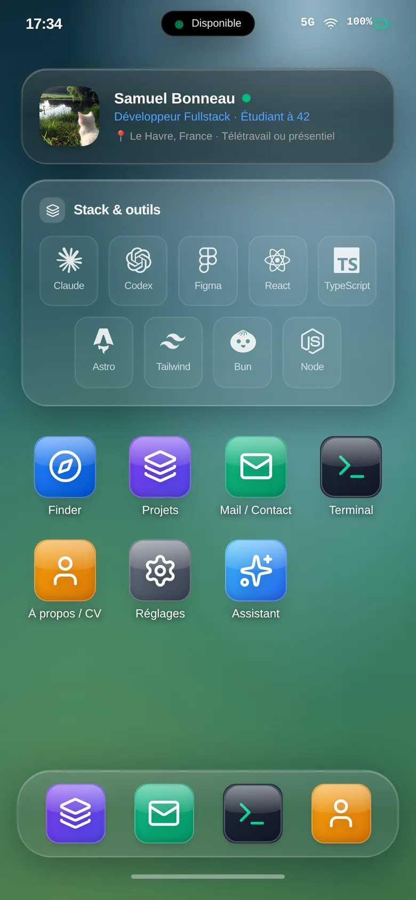

# Portfolio macOS & iOS dans le navigateur

Portfolio interactif de **Samuel Bonneau**, développeur Fullstack et étudiant à 42 Le Havre, en recherche d'alternance ou de stage pour 2026.

Sur ordinateur, le site reproduit un bureau macOS. Sur mobile, il devient un écran d'accueil iOS. Projets, CV et contact sont rangés dans des applications qu'on ouvre, déplace et redimensionne comme sur un vrai système.

<p align="center">
  
</p>

## Aperçu

| Bureau | Profil / CV |
| --- | --- |
|  |  |

| Terminal |
| --- |
|  |

<p align="center">
  
  
  
</p>

## Fonctionnalités

- **Écran de verrouillage** : horloge en direct, liens GitHub, LinkedIn et mail. On déverrouille d'un clic ou avec Entrée sur ordinateur, en glissant le curseur sur mobile. Le menu de la barre du haut permet de reverrouiller.
- **Bureau macOS** : barre de menus, icônes de bureau, menu contextuel, dock avec effet de grossissement.
- **Fenêtres** : déplacement, redimensionnement, réduction, plein écran et passage au premier plan.
- **Spotlight** (`⌘K` ou `Ctrl+K`) : recherche dans les applications, les projets et les liens.
- **Centre de contrôle** : mode clair ou sombre, sons, fond d'écran.
- **Thème Aero glass** : barre de menus, dock, fenêtres et widgets en verre dépoli, icônes avec reflet.
- **Notifications** : en haut au centre sur ordinateur. Sur mobile, elles sortent de la Dynamic Island. Elles disparaissent seules, et le survol ou l'appui met le délai en pause.
- **Version mobile** : bascule automatique sous 768 px, avec écran d'accueil, widgets et applications en plein écran.
- **Applications** : Projets, À propos / CV, Contact, Terminal, Finder, Réglages et Assistant. Un easter egg se cache dans le Terminal.
- **Titre d'onglet animé** : le nom s'écrit lettre par lettre au chargement.
- **Sons d'interface** générés en Web Audio, sans aucun fichier audio.

Le formulaire de contact n'a pas de serveur : il ouvre la messagerie du visiteur avec le message déjà rempli.

## Stack

Astro 7 · React 19 · TypeScript · Tailwind CSS 4 · Framer Motion · Bun

## Démarrage

Prérequis : [Bun](https://bun.sh) et Node.js 22.12 ou plus récent.

```sh
bun install
bun run dev        # http://localhost:4321
bun run build      # site statique dans dist/
bun run preview    # sert le build localement
bun run typecheck
```

## Déploiement

Le build produit un site entièrement statique dans `dist/`, à servir avec n'importe quel hébergeur de fichiers statiques.

Avant de déployer, renseigne ton domaine dans `site`, dans `astro.config.mjs`. Il sert à l'URL canonique, au sitemap et aux aperçus de liens.

## Personnaliser

- **Contenu** : tout est dans `src/data/portfolio.ts` (profil, compétences, formation, projets, outils du widget, fonds d'écran).
- **Photo de profil et favicon** : `public/chat.png`, avec ses déclinaisons `favicon.png`, `apple-touch-icon.png` et `icon-192.png`.
- **Aperçu des liens partagés** : `public/og.jpg` (1200 × 630).
- **Métadonnées SEO** : `src/layouts/Layout.astro`.

## Structure

```
src/
├── components/
│   ├── apps/       # les applications (Projets, Terminal, Contact, …)
│   ├── desktop/    # coque macOS (écran de verrouillage, dock, barre de menus, notifications, …)
│   ├── ios/        # coque iOS (écran d'accueil, barre d'état, Dynamic Island)
│   ├── window/     # fenêtres (cadre, boutons)
│   └── ui/         # icônes, logo et sons
├── context/        # DesktopContext : état global du système
├── data/           # contenu du portfolio
├── layouts/        # page HTML, SEO, titre animé
└── types/          # types partagés
```

## Licence

MIT, voir [LICENSE](./LICENSE).
